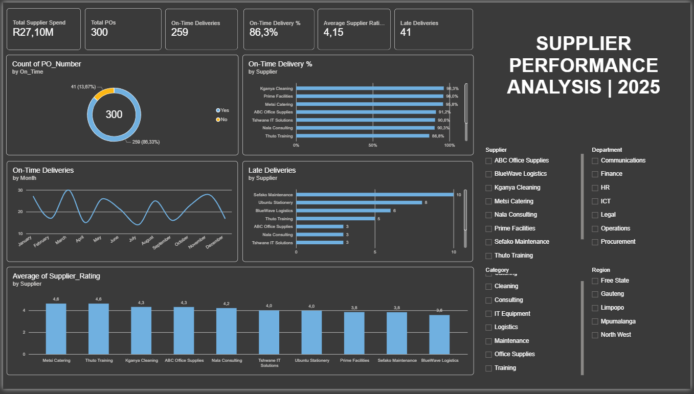

# Supplier Performance Analysis | 2025

Power BI dashboard evaluating supplier delivery performance, reliability, lead times, and supplier ratings.

## Dashboard Preview

## Tools
Power BI | Excel | DAX | Power Query

## Key Metrics
- Total Supplier Spend
- Purchase Orders
- On-Time Deliveries
- On-Time Delivery %
- Average Supplier Rating
- Late Deliveries

## Analysis
- Supplier delivery reliability
- Delivery lead times
- Supplier ratings comparison
- Monthly delivery performance trends

*Dataset: Synthetic procurement data created for analytical and portfolio purposes.*
